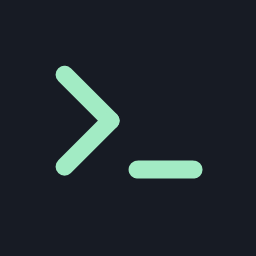
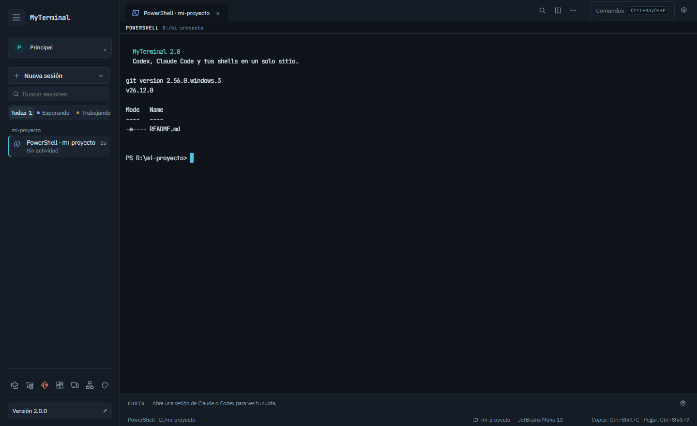
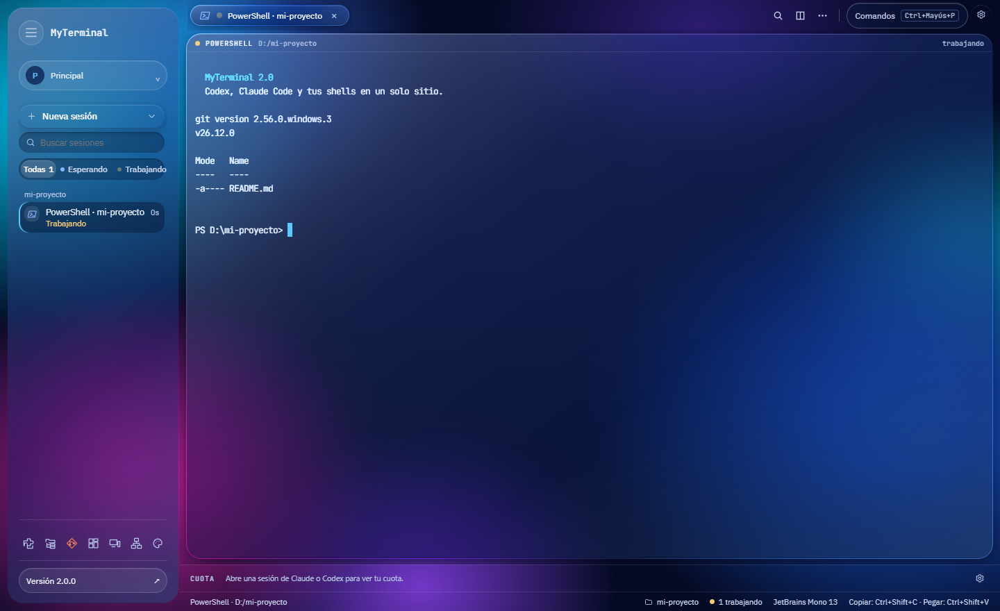
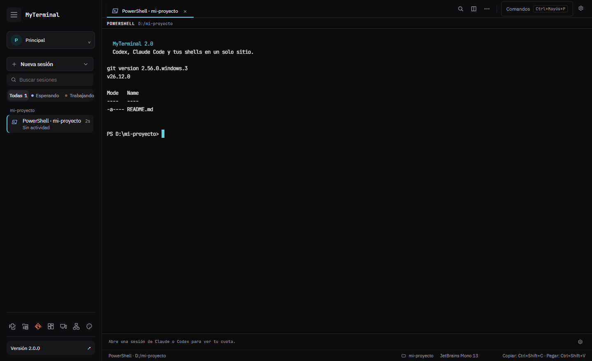
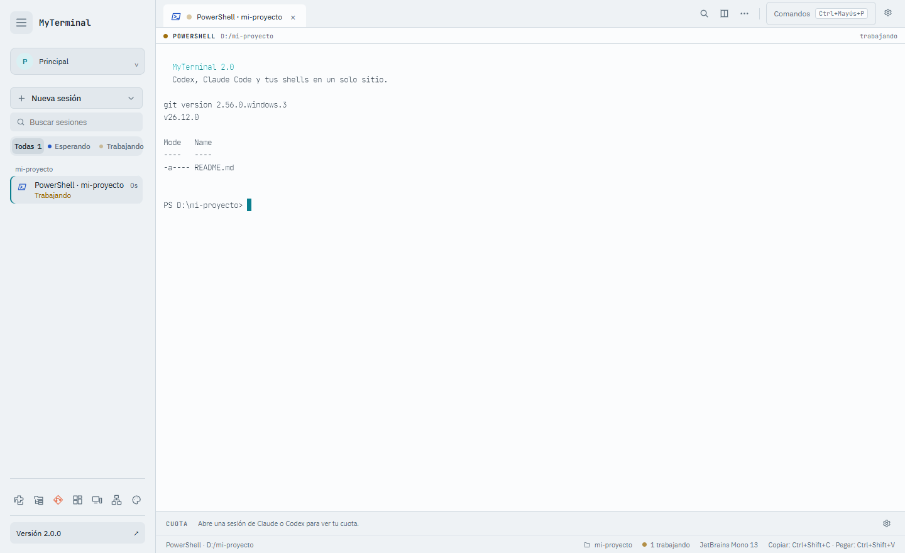
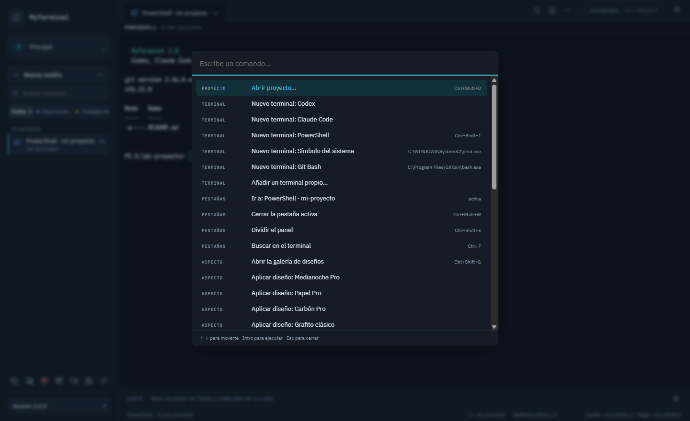

<div align="center">



# MyTerminal

**Codex, Claude Code y tus shells en un solo sitio.**<br>
Un terminal de escritorio para Windows pensado para trabajar con agentes de IA: sesiones por proyecto, cuota a la vista, SSH/SFTP/RDP y diseños que dan gusto mirar.

[](https://github.com/samaoff/myterminal/releases/latest)
[](LICENSE)


[**Descargar**](https://github.com/samaoff/myterminal/releases/latest) ·
[Guía](docs/guia.md) ·
[Desarrollo](docs/desarrollo.md) ·
[samaapp.es](https://samaapp.es)

<br>



</div>

---

> **English summary.** MyTerminal is a Windows desktop terminal built around AI coding agents (Codex, Claude Code) and your usual shells. Sessions grouped by project with live status, AI quota at a glance, a command palette, SSH/SFTP/embedded RDP, a second-screen mode and a gallery of themes. The UI is in Spanish. MIT licensed.

## ✨ Qué tiene

<table>
<tr>
<td width="50%" valign="top">

**🤖 Hecho para agentes de IA**
- Abre **Codex** o **Claude Code** en la carpeta del proyecto con un clic, usando tus propias cuentas: sin API extra y sin guardar claves.
- **Cuota a la vista**: una franja bajo el terminal muestra el uso de la IA de la pestaña activa.
- **Skills**: busca, previsualiza, importa o crea skills de Codex y Claude.
- **Consultar selección**: manda un trozo de salida a una sesión de IA.

</td>
<td width="50%" valign="top">

**🗂️ Sesiones que se entienden**
- Barra lateral con las sesiones **agrupadas por proyecto** y su estado: *trabajando*, *esperando*, *sin actividad*.
- Búsqueda, filtros, pestañas con color y nombre, y panel dividido.
- **Paleta de comandos** (`Ctrl+Mayús+P`) y atajos configurables.
- Restaura la sesión anterior y sigue en la bandeja al cerrar la ventana.

</td>
</tr>
<tr>
<td valign="top">

**🌐 Conexiones remotas**
- **SSH** con el cliente OpenSSH de Windows (alias, claves y agente).
- **SFTP** con explorador de dos paneles y transferencias múltiples.
- **Escritorio remoto (RDP)** dentro de una pestaña.
- Las contraseñas nunca se guardan.

</td>
<td valign="top">

**🖥️ Terminal de verdad**
- ConPTY real con **PowerShell 7, cmd, Git Bash y WSL** detectados, y terminales propios.
- Render por GPU, búsqueda, historial inteligente y bloques de comando con duración.
- Visor de cambios de Git y explorador de archivos integrados.
- **Segunda pantalla**: lleva el terminal a otro monitor, a una tableta o a un móvil por la red local.

</td>
</tr>
</table>

## 🎨 Diseños

Una galería con veinte diseños listos para usar, y los tuyos propios, que puedes exportar e importar.

<table>
<tr>
<td width="50%"><p align="center"><b>Cristal líquido</b></p></td>
<td width="50%"><p align="center"><b>Carbón Pro</b></p></td>
</tr>
<tr>
<td><p align="center"><b>Papel Pro</b></p></td>
<td><p align="center"><b>Paleta de comandos</b></p></td>
</tr>
</table>

## 📦 Instalar

1. Descarga `MyTerminal-Setup-<versión>.exe` de la [última versión](https://github.com/samaoff/myterminal/releases/latest).
2. Comprueba su suma con el archivo `.sha256` que lo acompaña (opcional):
   ```powershell
   Get-FileHash .\MyTerminal-Setup-2.0.0.exe -Algorithm SHA256
   ```
3. Ejecútalo. El instalador **todavía no está firmado**, así que Windows SmartScreen mostrará un aviso: pulsa **Más información → Ejecutar de todas formas**.

La app avisa sola cuando hay una versión nueva. Tus preferencias se guardan en `%APPDATA%\ai-terminal-pro` y se conservan al actualizar.

**Requisitos:** Windows 10 u 11 de 64 bits. Para usar los agentes, ten instalados [Codex](https://github.com/openai/codex) y/o [Claude Code](https://docs.claude.com/en/docs/claude-code/overview) con tu cuenta.

## 🛠️ Desarrollo

```powershell
git clone https://github.com/samaoff/myterminal.git
cd myterminal
npm install
npm start
```

| Comando | Qué hace |
| --- | --- |
| `npm start` | Abre la app desde el código (compila antes el componente RDP). |
| `npm run verify` | Sintaxis, ESLint sin avisos y pruebas unitarias. |
| `npm run smoke` | Arranca la app de verdad y prueba la interfaz con datos temporales. |
| `npm run dist` | Genera el instalador en `dist-pro/`. |

> Si tienes MyTerminal instalado y abierto, `npm start` cede el paso a esa instancia. Para probar el código a la vez, usa `npx electron . --user-data-dir=<carpeta temporal>`.

Hecho con [Electron](https://www.electronjs.org/), [xterm.js](https://xtermjs.org/) y [node-pty](https://github.com/microsoft/node-pty). Más detalles en [docs/desarrollo.md](docs/desarrollo.md); la guía de uso completa está en [docs/guia.md](docs/guia.md).

## 🔒 Privacidad y seguridad

- No hay telemetría. MyTerminal solo se conecta a internet para buscar actualizaciones, y a los servidores que tú abras por SSH, SFTP o RDP.
- La ventana funciona aislada (`sandbox`, `contextIsolation`): los canales internos solo responden a la propia app y no se abren ventanas ni navegación externas.
- La segunda pantalla solo acepta equipos de redes privadas y se empareja con QR o con un código de 6 cifras.

¿Has encontrado un fallo de seguridad? Escríbeme por privado en lugar de abrir una *issue* pública.

## 🤝 Contribuir

Las *issues* y las *pull requests* son bienvenidas. Antes de enviar cambios, pasa `npm run verify` y, si tocas la interfaz, `npm run smoke`. La app está en español; mantén los textos en español.

## 📄 Licencia

[MIT](LICENSE) © 2026 [samaapp](https://samaapp.es)
